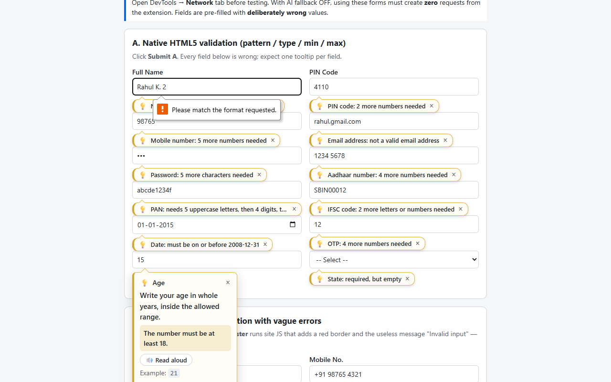
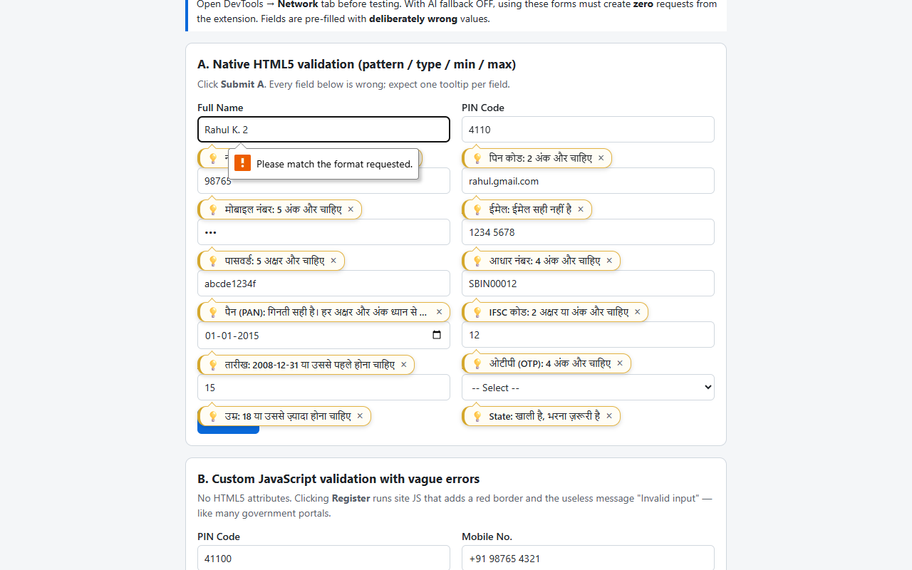
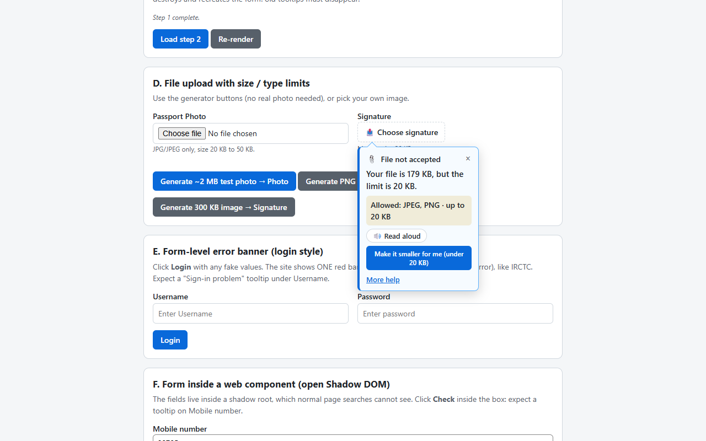
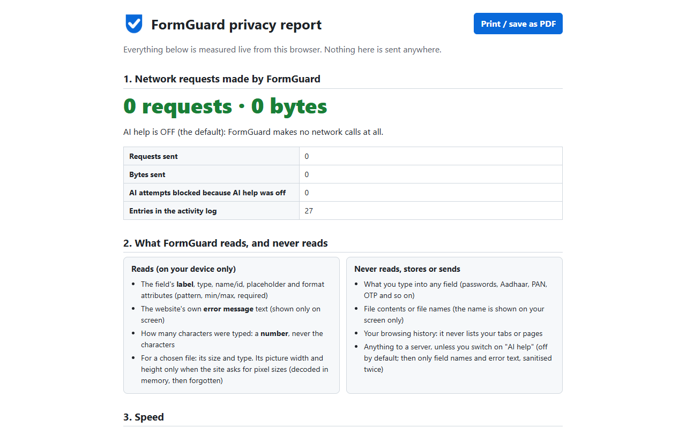

<div align="center">


# FormGuard

**Form errors, explained in plain language — without your data ever leaving your device.**

[](extension/manifest.json)
[](docs/PRIVACY.md)
[](#features)
[](docs/DEVELOPMENT.md#automated-tests)
[](LICENSE)

[Features](#features) · [Install](#install) · [Privacy](#privacy-by-design) · [Docs](#documentation)



</div>

---

## Why FormGuard?

Government and banking forms say things like *"Invalid input"* or *"File size exceeds limit"* and leave you guessing. FormGuard sits quietly in your browser, spots the field that went wrong, and tells you **what it needs, in one short sentence, with a fake example**. For photo and signature uploads it can even **fix the file for you**.

Built for ISRO problem statement **PS 26171**.

## Features

| | |
|---|---|
| 🔍 **Finds the error** | Detects fields in an error state on any site — including iframes and Shadow DOM. |
| 🗣️ **Explains it simply** | One sentence, one "do this" line (*"You typed 4. Add 2 more numbers."*) and a fake example. |
| 🇮🇳 **Knows Indian forms** | Aadhaar, PAN, IFSC, mobile, PIN code, GSTIN, UPI, IRCTC rules and more. |
| 🌐 **English & हिन्दी** | Switch language from the popup. |
| 🔢 **Live counter** | "5 of 10 numbers" turns green when you get it right. |
| 🖼️ **Fixes pictures** | Too big, wrong type or wrong pixel size? **Resize for me** fixes it on your device. |
| 🔊 **Read aloud** | Hear the explanation. |
| 📊 **Privacy report** | See requests sent, bytes sent, and permissions — live. |

<div align="center">


</div>

## Install

1. Clone or download this repo.
2. Open `chrome://extensions` and enable **Developer mode**.
3. Click **Load unpacked** and select the [`extension/`](extension) folder.
4. Open any form, click the FormGuard icon and press **Check this page**.

Want it to start by itself everywhere? Press **Turn on help for all websites** (optional permission, removable any time).

To try it safely: `npm run test-page` serves a practice form with every kind of error.

## Privacy by design

- **Never reads what you type** — only the *length* of a value.
- **Files are never uploaded** — only size, type and extension are checked.
- **Network code lives in one place** and refuses to run while AI fallback is OFF (default). Zero requests, verifiable in DevTools.
- **Local audit log** of every action and every byte sent.
- **Minimal permissions:** `activeTab`, `scripting`, `storage`. No `tabs`, `history` or `webRequest`.

<div align="center">

</div>

## Quality

```bash
npm test            # fast unit tests (rules, English + Hindi wording, sanitizer…)
npm run e2e         # real Chromium loads the extension and drives the test page
npm run e2e:sweep   # compatibility sweep of real Indian portals
```

## Documentation

| Doc | What's inside |
|---|---|
| [Development guide](docs/DEVELOPMENT.md) | Architecture, file map, permissions, tests, evaluation plan |
| [Privacy policy](docs/PRIVACY.md) | What is and isn't collected |
| [Compatibility](docs/COMPATIBILITY.md) | Browsers, page types, real-portal sweep |
| [Demo script](docs/DEMO.md) | 6-minute walkthrough |
| [Store listing](docs/STORE_LISTING.md) | Chrome Web Store draft |

## Contributing

Add a rule in [`extension/lib/rules.js`](extension/lib/rules.js) plus its English and Hindi wording in [`rulesText.js`](extension/lib/rulesText.js) — a unit test fails if Hindi is missing. Pull requests welcome.

## License

[MIT](LICENSE) © 2026 Durvesh
